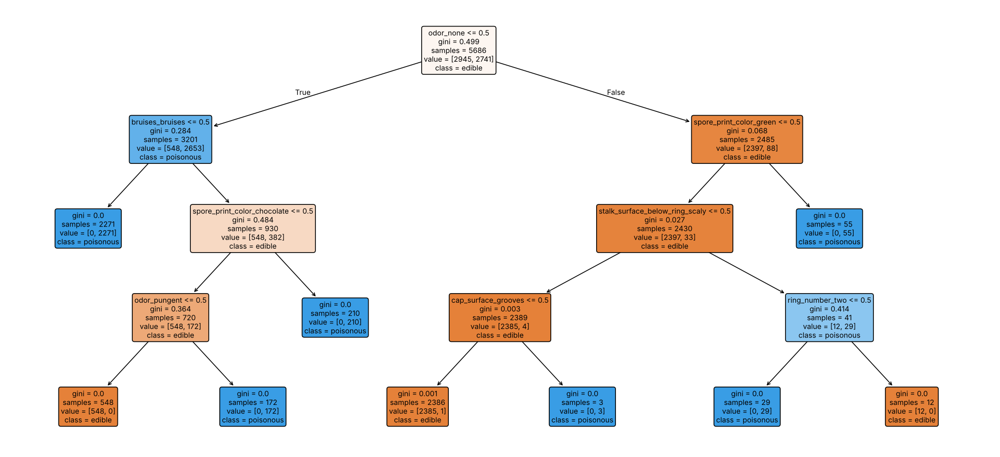

# Mushroom Classification: Edible vs. Poisonous

🇧🇷 [Leia em português](README.pt-BR.md)

A comparison of **K-Nearest Neighbors**, **Decision Tree** and **Naive Bayes** on the UCI Mushroom dataset, evaluated with a **safety-first metric**: the main goal is never to label a poisonous mushroom as edible.

> ⚠️ This is a machine-learning study on a historical, hypothetical dataset. **Do not use it to decide whether a real mushroom is safe to eat.**

## Results at a glance

| Rank | Model | Recall (poisonous), hold-out | Recall (poisonous), 5-fold CV | Accuracy, 5-fold CV | Poisonous missed (hold-out) |
|---|---|---|---|---|---|
| 🥇 | **KNN (k=5)** | **100.00%** | **100.00% ± 0.00** | **100.00%** | **0** |
| 🥈 | Decision Tree (max_depth=4) | 99.74% | 99.90% ± 0.10 | 99.95% | 3 |
| 🥉 | Naive Bayes (α=1) | 92.34% | 92.49% ± 1.31 | 96.09% | 90 |

**Recommendation:** KNN, which catches every poisonous mushroom across all validation folds. The decision tree is the interpretable alternative: its root split is `odor`, matching the best-known rule for this dataset.



## Problem framing

| Error | Consequence |
|---|---|
| Edible → predicted poisonous | A good mushroom is discarded. Low cost. |
| **Poisonous → predicted edible** | **Health risk. Unacceptable.** |

Models are therefore ranked by **recall on the `poisonous` class**, with **accuracy** as the tie-breaker. Classes are balanced (≈52/48), so accuracy remains meaningful as a secondary signal.

## Dataset

- **Source:** [UCI Machine Learning Repository: Mushroom](https://archive.ics.uci.edu/dataset/73/mushroom) (Schlimmer, 1987), based on *The Audubon Society Field Guide to North American Mushrooms* (1981).
- **Size:** 8,124 samples, 22 nominal attributes, binary target.
- **Format:** header-less CSV in which every value is a single-letter code. The legend is in `data/agaricus-lepiota.names`.

## Decisions and rationale

| # | Step | Decision | Rationale |
|---|---|---|---|
| 1 | Column names | Kept in English | Matches the official documentation, which makes verification easier. |
| 2 | Values | Letter codes → readable English labels | Easier inspection and interpretation. Unmapped codes become `NaN`, which serves as a completeness check. |
| 3 | `stalk_root` | **Dropped the column** | 2,480 missing values (≈30%). Dropping the column keeps all 8,124 rows; dropping rows would lose a third of the data. |
| 4 | `veil_type` | **Dropped** | A single value across all rows, so it has no discriminative power. |
| 5 | Split | **70/30, stratified**, `random_state=42` | Large, reliable test set; preserves the class ratio; reproducible. |
| 6 | Encoding | **One-Hot** for KNN and the tree, **Ordinal** for Naive Bayes | Ordinal codes would invent a false order for distance-based KNN. One-hot yields readable tree splits. `CategoricalNB` expects integer category labels. Encoders are fit on the training data only. |
| 7 | KNN | **k = 5** | scikit-learn default, used as a deliberate untuned starting point. An odd k avoids voting ties. |
| 8 | Decision Tree | **max_depth = 4** | Prioritizes interpretability. Kept unchanged after seeing the test result to avoid tuning on the test set. Trade-off: 3 poisonous mushrooms missed. |
| 9 | Naive Bayes | **`CategoricalNB`, α = 1.0** | Standard Laplace smoothing prevents unseen categories from zeroing out probabilities. |
| 10 | Metric | **Recall (poisonous)** first, accuracy second | Reflects the asymmetric cost of errors. |
| 11 | Robustness | **5-fold stratified CV** with pipelines | Confirms the hold-out result is not split luck. Pipelines prevent encoder leakage. |

## Key insights

- **`odor` is the dominant feature.** The decision tree chose it as the root split on its own, matching the published rule "odor not in {almond, anise, none} → poisonous" (≈98.5% accuracy by itself).
- **Naive Bayes fails because of correlated features.** The data describes 23 species, each defined by a *combination* of traits. The independence assumption double-counts evidence, causing 90 poisonous mushrooms to be missed. KNN and the tree exploit feature combinations directly.
- **Interpretability has a measurable cost.** Limiting the tree to depth 4 costs about 0.1–0.3 percentage points of recall.

## Limitations and next steps

- **Near-separable data:** perfect scores reflect an almost deterministic dataset, not real-world field performance.
- **Hypothetical samples:** the records come from field-guide descriptions, not measured specimens, and "unknown edibility" species were merged into the poisonous class.
- **Discarded signal:** missing `stalk_root` values are concentrated in poisonous samples (1,760 vs. 720). Treating the gap as a `missing` category could recover that information.
- **No hyperparameter tuning:** `k`, `max_depth` and `α` were set by reasoning. A nested-CV grid search is the natural next step.
- **Deployment:** a cost-sensitive analysis of probability thresholds would make the safety trade-off explicit.

## Project structure

```
mushroom-classification/
├── data/
│   ├── agaricus-lepiota.data        # raw dataset
│   └── agaricus-lepiota.names       # official documentation
├── notebooks/
│   └── mushroom_classification.ipynb
├── reports/figures/
│   └── decision_tree.png
├── requirements.txt
├── README.md
└── README.pt-BR.md
```

## How to run

```bash
pip install -r requirements.txt
cd notebooks
jupyter notebook mushroom_classification.ipynb
```

## Tech stack

Python · pandas · scikit-learn · matplotlib · Jupyter
